# GrzyBet

GrzyBet to aplikacja na Androida do wspólnego grzybobrania ze znajomymi. Twórz wyprawy, typuj wyniki, zgłaszaj zbiory i rozwijaj swój Grzybedex.

Projekt powstał w **React Native z wykorzystaniem Expo**. Główną platformą jest **Android**. Aplikacja była testowana na fizycznym urządzeniu **Google Pixel 10 Pro**.

## Instalacja i uruchomienie

1. Pobierz plik APK GrzyBet udostępniony przez autora. Opublikowane wersje znajdziesz w sekcji [Releases](https://github.com/Kapusniacz3k/GrzybApp/releases).
2. Otwórz pobrany plik. Jeśli Android poprosi o zgodę na instalację z tego źródła, udziel jej aplikacji, z której otwierasz APK.
3. Zainstaluj i uruchom GrzyBet.

Na emulatorze Androida przeciągnij plik APK na okno uruchomionego emulatora, a następnie otwórz GrzyBet z listy aplikacji.

Do wspólnej gry potrzebujesz połączenia z internetem i co najmniej dwóch uczestników. Każdy korzysta ze swojego telefonu lub osobnej instancji emulatora. Możesz zacząć jako gość, bez zakładania konta.

## Jak grać

1. Wybierz nick, utwórz pokój lub dołącz kodem otrzymanym od znajomego.
2. Poczekaj, aż gospodarz rozpocznie typowanie lub otworzy zakłady.
3. Zatwierdź swoje typy albo zakończ stawianie kuponów.
4. Gdy gospodarz uruchomi poszukiwania, dodawaj zdjęcia zbiorów z gatunkiem i liczbą sztuk.
5. Gospodarz zatwierdza zgłoszenia i kończy wyprawę. Wtedy w zakładce **Wyniki** pojawi się podsumowanie gry.

- **Typowanie** — odpowiadasz na cztery pytania o wyniki zbiorów. Jedną odpowiedź możesz oznaczyć jako **pewniak ×2**. W pytaniach liczbowych punkty otrzymasz także za bliski wynik, a podsumowanie pokaże sposób ich naliczenia.
- **Kupony** — na każdą wyprawę otrzymujesz nowe **10 wirtualnych grzybków**. Wybierasz zakłady, łączysz je w kupony i ustalasz stawkę. Po zakończeniu wyprawy zobaczysz ich rozliczenie. Grzybki to wyłącznie punkty w grze, bez zakupu i wypłaty pieniędzy.

Wszystkie aktywne wyprawy znajdziesz na ekranie startowym i w profilu. Przed startem gry uczestnik może opuścić lobby. Gospodarz może anulować trwającą wyprawę — bez rozliczania wyników, z zachowaniem zatwierdzonych zbiorów w Grzybedexie.

Niewysłany szkic zbioru zapisuje się na tym urządzeniu. Po utracie połączenia możesz przeglądać ostatnio zapisane dane i przygotować szkic; wysyłanie i zmiany w grze wymagają internetu. Zdjęcia zgłoszeń otworzysz przyciskiem **Pokaż zdjęcie**.

## Profil i kolekcja

- **Grzybedex** zawiera **100 gatunków** z wyszukiwaniem po nazwach polskich, potocznych i łacińskich. Nieodkryte grzyby mają szare zdjęcie i kłódkę; po otwarciu kafelka od razu zobaczysz kolorowe zdjęcie i notatkę. Pierwszy zatwierdzony zbiór usuwa szarość i kłódkę.
- Szczegóły gatunku pokazują jadalność ze źródłem i ewentualnymi warunkami spożycia, łączną liczbę zebranych sztuk, rekord jednej wyprawy, zdobytą odznakę i postęp do następnej. Oznaczenie jadalności nie potwierdza rozpoznania znalezionego okazu.
- Przycisk **Cechy** prowadzi krok po kroku przez filtrowanie według koloru, spodu kapelusza, kształtu i miejsca występowania. To pomoc w porównaniu gatunków, która nie potwierdza jadalności grzyba.
- **Profil** pokazuje Twój dorobek. Pod statystykami są dwa kafelki: **Aktywne wyprawy** i **Historia wypraw** — każdy otwiera osobne okno z listą.
- Możesz grać jako gość lub zabezpieczyć konto e-mailem i hasłem, aby wrócić do swojego postępu na innym telefonie. Dostępne są także logowanie, odzyskiwanie hasła i usunięcie konta z dodatkowym potwierdzeniem.
- W **Ustawieniach** wybierzesz jasny lub ciemny motyw.

## Zrzuty ekranu

Poniżej przygotowano **18 miejsc na zrzuty**. Zapisz pionowe obrazy PNG w folderze `docs/screenshots/`, używając nazw z [listy zrzutów](docs/screenshots/README.md). Po dodaniu plików pojawią się w galerii.

<!-- Miejsca na rzeczywiste zrzuty aplikacji, nie gotowe screeny. Nazwy i proponowana zawartość: docs/screenshots/README.md. -->

| Ekran główny | Pokój wyprawy | Typowanie |
| --- | --- | --- |
| 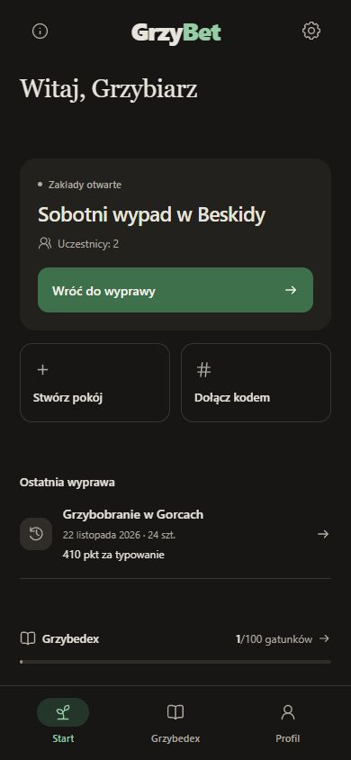 |  | 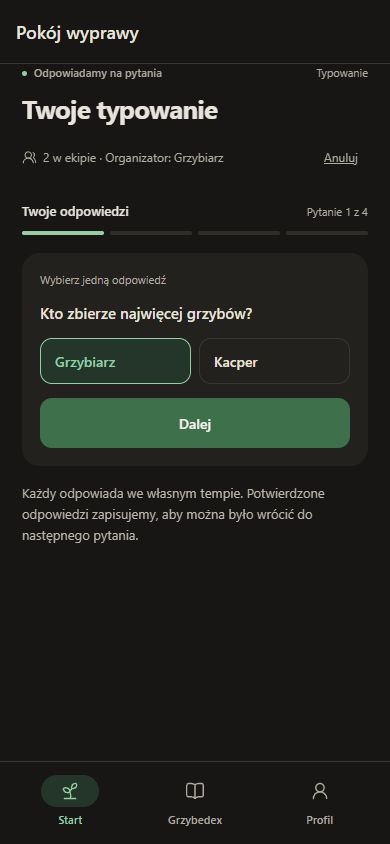 |

| Podsumowanie typów | Zakłady i kursy | Kupon |
| --- | --- | --- |
| 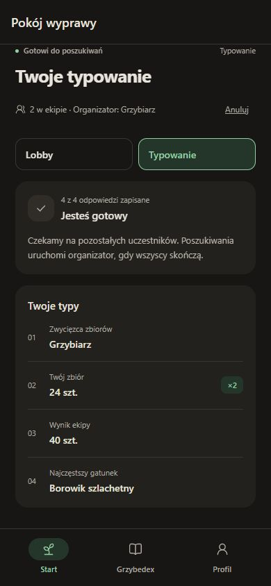 | 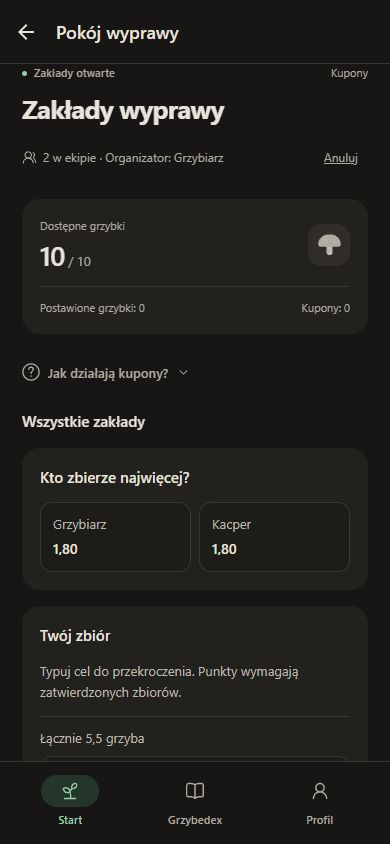 | 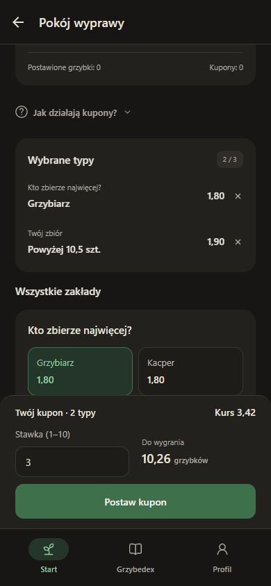 |

| Dodawanie zbioru | Ocena zgłoszeń | Wyniki wyprawy |
| --- | --- | --- |
| 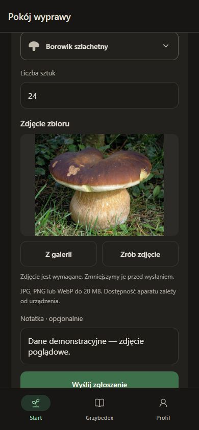 | 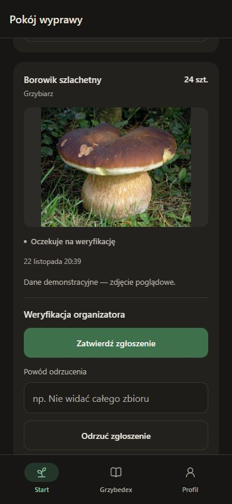 |  |

| Grzybedex i wyszukiwanie | Szczegóły gatunku | Filtrowanie po cechach |
| --- | --- | --- |
|  | 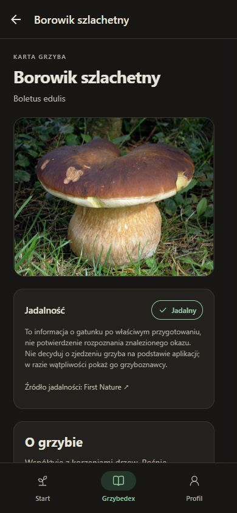 | 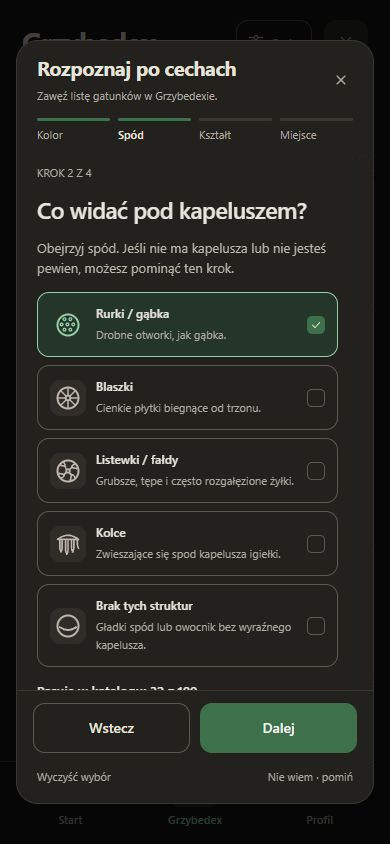 |

| Profil i dorobek | Aktywne wyprawy | Historia wypraw |
| --- | --- | --- |
| 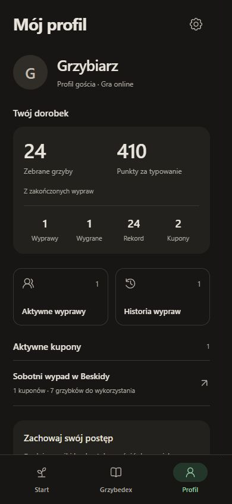 | 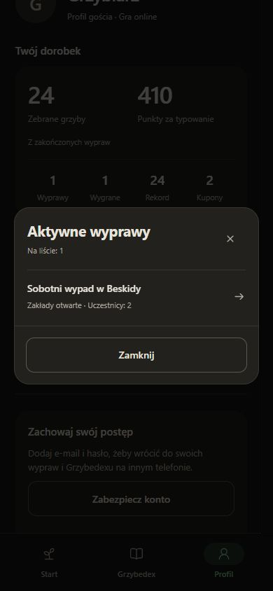 | 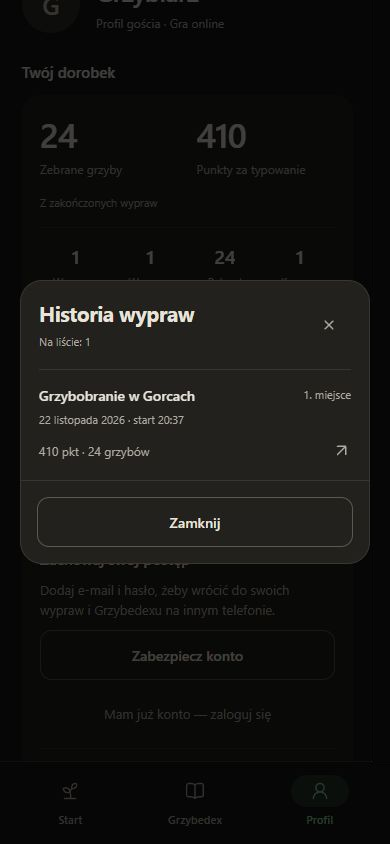 |

| Logowanie i konto | Usuwanie konta | Ustawienia i jasny motyw |
| --- | --- | --- |
| 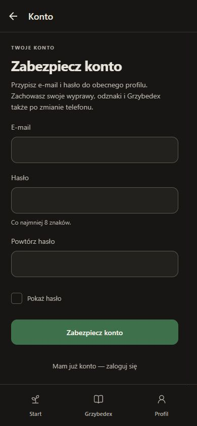 | 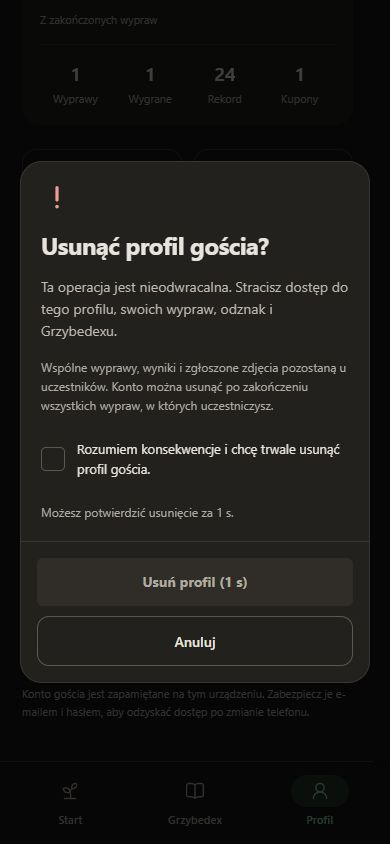 | 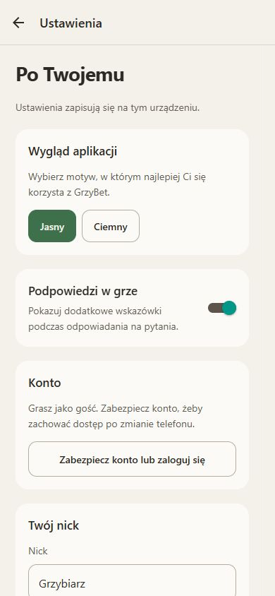 |

[Autorzy i licencje zdjęć](assets/images/grzybdex/CREDITS.md)
