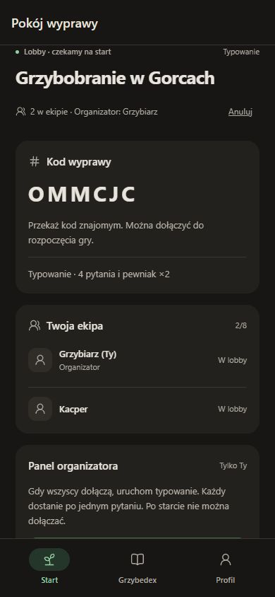
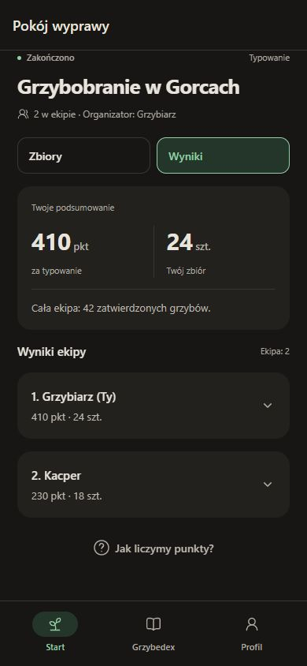
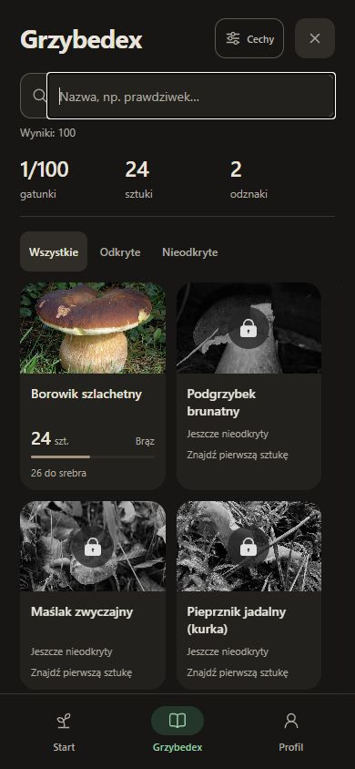

# GrzyBet

GrzyBet to aplikacja na Androida do wspólnego grzybobrania ze znajomymi. Twórz wyprawy, typuj wyniki, zgłaszaj zbiory i rozwijaj swój Grzybedex.

Projekt powstał w **React Native z wykorzystaniem Expo**. Główną platformą jest **Android**. Aplikacja była testowana na fizycznym urządzeniu **Google Pixel 10 Pro**.

## Instalacja i uruchomienie

1. Pobierz plik APK GrzyBet udostępniony przez autora. Opublikowane wersje znajdziesz w sekcji [Releases](https://github.com/Kapusniacz3k/GrzybApp/releases).
2. Otwórz pobrany plik. Jeśli Android poprosi o zgodę na instalację z tego źródła, udziel jej aplikacji, z której otwierasz APK.
3. Zainstaluj i uruchom GrzyBet.

Na emulatorze Androida przeciągnij plik APK na okno uruchomionego emulatora, a następnie otwórz GrzyBet z listy aplikacji.

Do wspólnej gry potrzebujesz połączenia z internetem i co najmniej dwóch uczestników. Każdy korzysta ze swojego telefonu lub osobnej instancji emulatora. Możesz zacząć jako gość, bez zakładania konta.

## Jak grać

1. Wybierz nick, utwórz pokój lub dołącz kodem otrzymanym od znajomego.
2. Poczekaj, aż gospodarz rozpocznie typowanie lub otworzy zakłady.
3. Zatwierdź swoje typy albo zakończ stawianie kuponów.
4. Gdy gospodarz uruchomi poszukiwania, dodawaj zdjęcia zbiorów z gatunkiem i liczbą sztuk.
5. Gospodarz zatwierdza zgłoszenia i kończy wyprawę. Wtedy w zakładce **Wyniki** pojawi się podsumowanie gry.

W trybie **Kupony** każdy otrzymuje na wyprawę 10 wirtualnych grzybków do obstawiania. Są to wyłącznie punkty w grze, bez zakupu i wypłaty pieniędzy.

## Profil i kolekcja

- **Grzybedex** zawiera 100 gatunków z wyszukiwaniem po nazwach polskich, potocznych i łacińskich. Zatwierdzone zbiory odblokowują zdjęcia, notatki i odznaki.
- **Profil** pokazuje statystyki oraz historię wypraw.
- Możesz grać jako gość lub zabezpieczyć konto e-mailem i hasłem, aby wrócić do swojego postępu na innym telefonie.
- W **Ustawieniach** wybierzesz jasny lub ciemny motyw.

## Zrzuty ekranu

<!-- Miejsca na rzeczywiste zrzuty aplikacji. Dodaj pliki o poniższych nazwach do docs/screenshots/, aby obrazy były widoczne. -->

| Ekran główny | Pokój wyprawy | Typowanie |
| --- | --- | --- |
|  |  |  |

| Zbiory | Wyniki | Grzybedex |
| --- | --- | --- |
|  |  |  |

[Autorzy i licencje zdjęć](assets/images/grzybdex/CREDITS.md)
